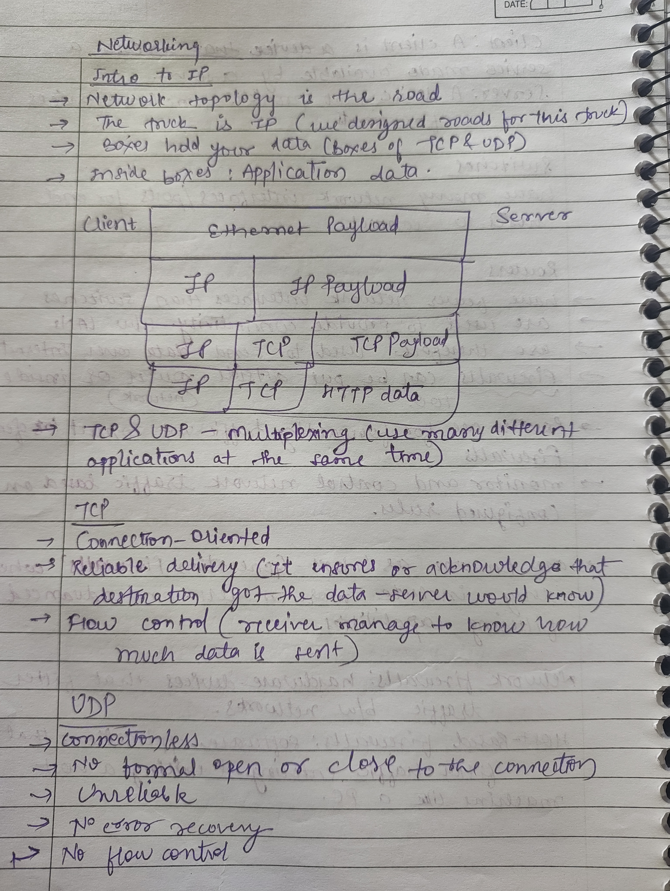

# IP Communication, TCP, UDP and Ports

## 1. Introduction to IP

The Internet Protocol (IP) provides logical addressing and enables packets to travel between networks.

- IPv4 uses 32-bit addresses.
- IPv6 uses 128-bit addresses.
- IP provides addressing and routing.
- IP itself does not guarantee delivery, ordering or retransmission.

### Client and Server

- **Client:** A device or application that requests a service.
- **Server:** A device or application that provides a service.

Example: A browser (client) requests a webpage from a web server.

### Encapsulation

As application data moves through the network stack, protocol information is added at different layers.

| Layer | Example |
|---|---|
| Application | HTTP data |
| Transport | TCP segment or UDP datagram |
| Network | IP packet |
| Data Link | Ethernet frame |
| Physical | Bits |

At the receiving device, the process is reversed through decapsulation.

## 2. TCP — Transmission Control Protocol

TCP is a connection-oriented transport protocol.

Key characteristics:

- Establishes a connection before data transfer.
- Provides reliable, ordered delivery.
- Uses acknowledgements and retransmissions.
- Provides flow control.
- Uses sequence numbers to track transmitted data.

**Purpose:** Reliable communication when data must arrive correctly and in order.

## 3. UDP — User Datagram Protocol

UDP is a connectionless transport protocol.

Key characteristics:

- Does not establish a connection before sending data.
- Does not guarantee delivery.
- Does not guarantee packet ordering.
- Does not provide TCP-style retransmission or built-in flow control.
- Has a smaller transport header than TCP.

**Purpose:** Lightweight communication where low overhead and timely delivery may be more important than guaranteed delivery.

### TCP vs UDP

| TCP | UDP |
|---|---|
| Connection-oriented | Connectionless |
| Reliable delivery | No delivery guarantee |
| Ordered delivery | No ordering guarantee |
| Acknowledgements and retransmissions | No built-in acknowledgements or retransmissions |
| Higher protocol overhead | Lower protocol overhead |

Both TCP and UDP use port numbers to identify application endpoints.

## 4. Network Ports

A port number identifies an application endpoint on a device and works with an IP address and transport protocol.

TCP and UDP maintain separate port-number spaces.

### Port Number Ranges

| Range | Classification |
|---|---|
| 0–1023 | Well-known ports |
| 1024–49151 | Registered ports |
| 49152–65535 | Dynamic/private ports |

Dynamic ports are commonly used temporarily by client applications.

### Important Concepts

- A service commonly listens on a configured port.
- A client typically uses a temporary source port.
- A connection is identified using source and destination IP addresses and ports, together with the transport protocol.
- The same numeric port can be used independently by TCP and UDP.

## 5. Network Communication Types

### Unicast
One sender communicates with one receiver.

Example: A client requests data from a server.

### Multicast
One sender sends traffic to a group of interested receivers.

Used for suitable group communication and streaming applications.

### Anycast
One destination address is associated with multiple possible receivers. Routing directs traffic to one selected destination, often based on routing topology.

### Broadcast
One sender communicates with all devices in a broadcast domain.

IPv4 supports broadcast. IPv6 does not use broadcast; it uses multicast for similar group communication purposes.

## Security and Investigation Relevance

Understanding IP, transport protocols and ports helps when:

- Analysing network connections.
- Identifying which applications may be communicating.
- Examining firewall logs.
- Investigating unusual inbound or outbound connections.
- Interpreting packet captures in Wireshark.

A port number alone does not prove which application generated traffic or whether activity is malicious.

## Learning Reference

- Professor Messer
- Jeremy's IT Lab
- Original handwritten Phase 1 networking notes

## Handwritten Learning Notes

