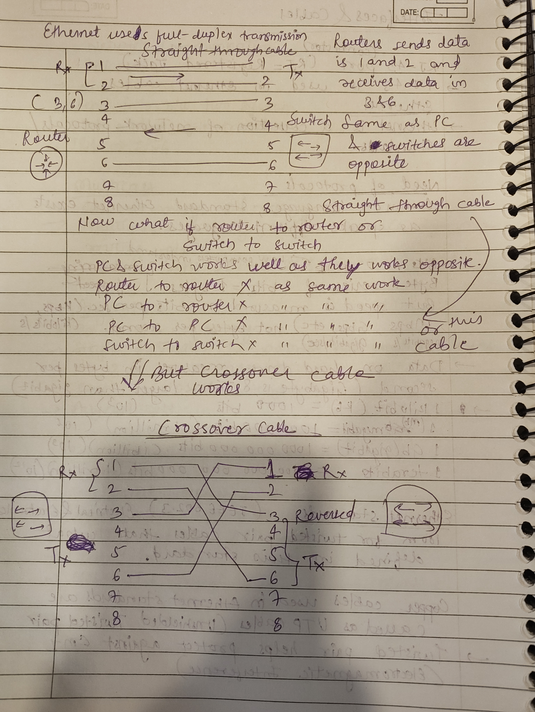
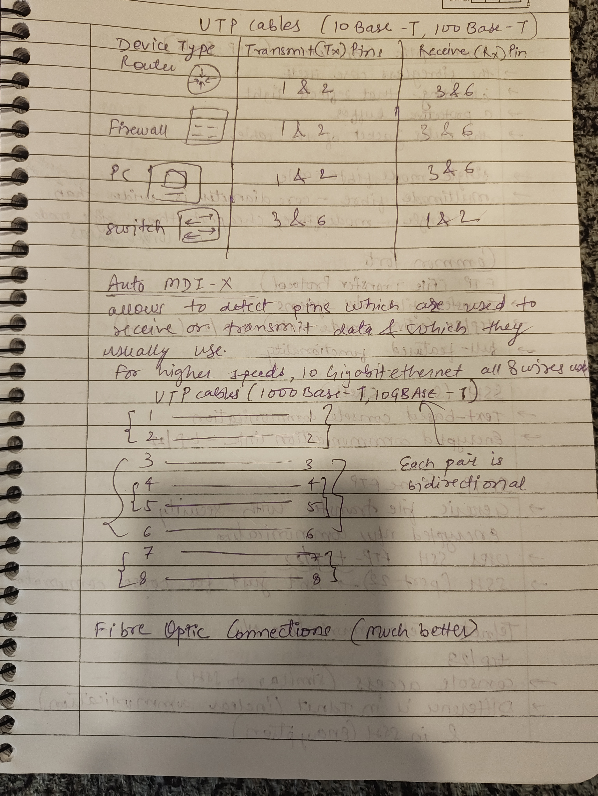

# Network Interfaces and Cables

## 1. Network Interfaces

A network interface allows a device to connect and communicate over a network.

Examples include:
- Ethernet network interface cards (NICs)
- Wireless network adapters
- Fibre-optic network interfaces

A NIC provides the physical or wireless connectivity required for network communication.

## 2. RJ45 Connector and Ethernet

RJ45 is the common name used for the 8-position modular connector commonly found on Ethernet twisted-pair cables.

Ethernet defines standards for wired local-area network communication.

### Common Ethernet Standards

| Standard | Typical speed |
|---|---:|
| 10BASE-T | 10 Mbps |
| 100BASE-TX | 100 Mbps |
| 1000BASE-T | 1 Gbps |

The actual supported speed depends on the cable category, equipment and link configuration.

## 3. Data Rate Units

- **bit (b):** A binary digit.
- **byte (B):** 8 bits.
- **Mbps:** Megabits per second.
- **MB/s:** Megabytes per second.
- **Gbps:** Gigabits per second.

**Remember:** Network speeds are commonly expressed in bits per second, while file sizes are commonly expressed in bytes.

For example, 100 Mbps is theoretically equivalent to 12.5 MB/s before protocol overhead and other limitations.

## 4. Twisted-Pair Ethernet Cables

Ethernet twisted-pair cables contain pairs of insulated copper wires twisted together.

Twisting helps reduce electromagnetic interference and crosstalk.

### Straight-Through Cable

- Uses the same wiring standard at both ends.
- Commonly used to connect unlike device types, such as a PC to a switch.

### Crossover Cable

- Uses different wiring standards at the two ends: T568A at one end and T568B at the other.
- Historically used to connect similar Ethernet interfaces, such as switch-to-switch connections.

### Auto MDI-X

Modern Ethernet interfaces may support Auto MDI-X, which automatically detects and adjusts transmit and receive pair configuration.

This reduces the need to select straight-through or crossover cables manually.

## 5. Fibre-Optic Cables

Fibre-optic cables transmit data using light rather than electrical signals.

### Types

| Single-mode fibre | Multimode fibre |
|---|---|
| Smaller core | Larger core |
| Uses a narrow light path | Supports multiple light paths |
| Suitable for longer distances | Commonly used for shorter distances |
| Common in long-distance links | Common in buildings and campuses |

### Advantages

- Supports high bandwidth.
- Suitable for long-distance communication.
- Immune to electromagnetic interference.

## Security and Investigation Relevance

Understanding network interfaces and transmission media helps when identifying how devices connect, interpreting network topology and understanding the physical path through which network traffic travels.

---

## Learning Reference

- Original handwritten Phase 1 networking notes
- Professor Messer
- Jeremy's IT Lab

## Handwritten Learning Notes

### Straight-Through and Crossover Cable — Page 1

### Straight-Through and Crossover Cable — Page 2

